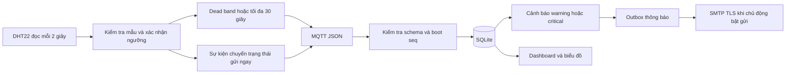

# Đối chiếu và ứng dụng các bài lab IoT

Nguồn: 10 file trong `D:\StudyMaterials\HK7\IOT\Project\lab` gồm Lab 1–9 và Lab 5_1. Các bài lab là tài liệu tham khảo kỹ thuật; đề tài vẫn là hộp thuốc thông minh.

## Phạm vi ứng dụng

| Lab | Nội dung phù hợp | Ứng dụng trong hệ thống |
|---|---|---|
| 1 | GPIO, INPUT_PULLUP, debounce, DHT22, trạng thái | Ba nút chống dội 35 ms; LED/buzzer theo ngăn; kiểm tra mẫu cảm biến |
| 2 | millis, nhiều chu kỳ độc lập, máy trạng thái | Quét nút, đọc DHT 2 giây, heartbeat 5 giây; MQTT chạy worker riêng |
| 3 | Wi-Fi tự nối lại, NTP, giữ giờ khi mất mạng | Kết nối lại có khoảng chờ; UTC cho TLS/nạp; board thật cập nhật RTC từ UTC lúc có giờ hợp lệ và mỗi 6 giờ; Wokwi giữ RTC/TIME độc lập |
| 4 | HTTP POST, JSON, Bearer token, timeout | API kiểm thử telemetry dùng chung validator MQTT, admin mới gửi được; body tối đa 8 KiB; client timeout 8 giây |
| 5 | MQTT Pub/Sub, callback, reconnect, LWT | Topic riêng theo ID, retained trạng thái và LWT, đăng ký lại command khi nối lại |
| 5_1 | Mosquitto local, Paho Gateway, wildcard, ACL | `deploy/` có Mosquitto TLS/ACL; Gateway gom nhiều hộp, SQLite và `/live` tổng hợp |
| 6 | ArduinoJson, lệnh đa thiết bị, ACK, RSSI | JSON theo boot/seq, ID hộp, command_id; heartbeat bổ sung RSSI/IP; ACK có thời gian đo tại Gateway |
| 7 | Dashboard, history chart, điều khiển, read-only | Biểu đồ môi trường 1 giờ/24 giờ; layout desktop/mobile; family bị chặn API điều khiển và ẩn nút |
| 8 | Đồng bộ boot/reconnect, đo trễ, dead-band | Gửi trạng thái khi đổi/nối lại, lọc 0,3 °C/2% RH, gửi tối đa cách nhau 30 giây; lệnh chờ quá 60 giây chuyển TIMEOUT |
| 9 | Filter, Alarm, Warning/Critical, recovery, notification | Cảnh báo đã được firmware xác nhận; nâng critical khi >35 °C hoặc >85% RH; outbox bền vững cho OPEN/ESCALATED/RECOVERED; SMTP TLS tùy chọn |

Giữ ngưỡng cảnh báo 30 °C/70% RH và hồi phục 28 °C/68% với 3 mẫu của firmware. Mức critical là ví dụ kiểm thử, không phải tiêu chuẩn bảo quản mọi loại thuốc. Gateway dựa vào trạng thái WARNING đã xác nhận, không bỏ qua bộ lọc chống dao động trên thiết bị.

Khi đã critical, Gateway chỉ hạ về warning khi nhiệt độ ≤33 °C và độ ẩm ≤83% RH, hoặc đóng cảnh báo khi nhận NORMAL đã xác nhận; khoảng trễ này hạn chế dao động thông báo quanh 35 °C/85% RH.

## Luồng xử lý



ACK latency là chênh lệch giữa lúc Gateway lưu lệnh và nhận ACK, không phải phép đo GPIO hay bảo đảm độ trễ mạng. TIMEOUT được cập nhật khi API được truy cập, không có daemon timeout riêng. ACK đến sau TIMEOUT không đổi kết quả lệnh thành thành công; cần đọc trạng thái thiết bị trước khi gửi lại.

Lịch nhắc và thao tác vật lý tiếp tục cục bộ khi mất mạng. FIFO sự kiện vẫn nằm trong RAM, chưa bảo đảm lưu bền vững hay exactly-once đầu cuối. NVS lưu cấu hình và ledger hoàn tất, không thay thế hàng đợi sự kiện.

## Kiểm thử HTTP bằng Postman hoặc curl

Chạy `gateway.local_system`: HTTP ingest chỉ mở tại chế độ local và chỉ admin được gửi. Gateway thông thường phải đặt `PILLBOX_HTTP_INGEST=1` nếu muốn bật API kiểm thử; mặc định tắt. Không dùng API kiểm thử để giả mạo bản tin của thiết bị đang hoạt động.

Ví dụ PB06 trên DB kiểm thử riêng:

```http
POST /api/devices/PB06/telemetry
Authorization: Bearer <khóa ADMIN01>
Content-Type: application/json

{
  "kind": "environment",
  "message": {
    "device_id": "PB06", "boot_id": "postman-lab", "seq": 1,
    "sensor_ok": true, "temperature_c": 40, "humidity_percent": 75,
    "storage_status": "WARNING"
  }
}
```

Kỳ vọng 201. Đổi seq tăng dần cho mỗi mẫu; giữ seq để thử chống trùng. Thử 32 °C/75% WARNING, 40 °C/75% WARNING, rồi 25 °C/50% NORMAL để quan sát warning, critical và recovery. Thiếu khóa 401, nurse/family gửi 403, JSON sai 400, body quá 8 KiB trả 413.

Lịch sử: `GET /api/devices/PB06/environment/history?hours=1` hoặc `hours=24`. API gom mẫu theo phút hoặc 10 phút, tối đa 145 điểm, dùng thời điểm Gateway nhận dữ liệu để không trộn giờ RTC mô phỏng với UTC. RSSI/IP chỉ hiện khi firmware thật/Wokwi gửi, không điền tín hiệu Wi-Fi giả cho local simulator.

## Thông báo cảnh báo

`alert_notifications` là outbox trong SQLite. Chỉ tạo bản ghi khi mở cảnh báo, nâng mức critical hoặc hồi phục; heartbeat lặp không tạo thêm thông báo. Ghi nhận outbox không đồng nghĩa email đã được gửi.

Kiểm tra an toàn, không gửi email:

```bash
./.venv/Scripts/python.exe -m gateway.notifications --db gateway/data/pillbox.db
```

Để triển khai gửi thật, quản trị viên cấu hình `PILLBOX_SMTP_HOST`, `PILLBOX_SMTP_PORT` (587 STARTTLS hoặc 465 TLS), `PILLBOX_SMTP_FROM`, `PILLBOX_SMTP_TO`; nếu cần xác thực, đặt đủ `PILLBOX_SMTP_USER` và `PILLBOX_SMTP_PASSWORD`. Sau khi xác nhận người nhận và dịch vụ, quản trị viên chủ động chạy CLI với `--send`. Không có tiến trình tự gửi email khi khởi động web.

TLS kiểm tra chứng chỉ, timeout 5 giây; một thông báo thất bại được thử tối đa 3 lần qua các lần gọi CLI. Gửi thành công không được lấy lại ở lần chạy tiếp theo. Nếu tiến trình chết sau khi SMTP nhận thư nhưng trước khi lưu SENT, bản ghi có thể nằm SENDING: cần kiểm tra log máy chủ thư trước khi xử lý thủ công, chưa bảo đảm exactly-once. Bộ test dùng transport giả lập, chưa gửi email/Telegram thật.

## Nội dung không bật mặc định

- Không dùng `delay()` dài hoặc deep sleep vì phải quét nút và nhận lệnh liên tục.
- Không tự reset sau ba lần ping Internet thất bại: broker nội bộ vẫn có thể hoạt động, reset làm mất FIFO RAM.
- Chưa thêm captive portal mở hoặc hardcode mật khẩu vào Git; giữ cấu hình riêng từng thiết bị. Cần nút provisioning và phần cứng thật trước khi triển khai portal.
- Không thêm LCD, LDR, relay, cân hay actuator không phục vụ mạch hiện có chỉ để khớp tên bài lab.
- Không thay Dashboard bằng Blynk/ThingsBoard/Node-RED hoặc yêu cầu tài khoản cloud mới. Các mô hình widget/rule chain được áp dụng trong Gateway hiện có.
- Docker Mosquitto TLS/ACL có cấu hình triển khai, chưa có bằng chứng nghiệm thu mạng/board thật trong lần cập nhật này. NTP và RTC thật mới được kiểm tra build, cần đo lệch giờ trên board.

## Bằng chứng kiểm thử

`gateway/tests/test_lab_integration.py` kiểm tra rule chain, chống trùng, phân quyền read-only, HTTP schema/body limit, bucket lịch sử, timeout/ACK latency và outbox. Host C++ kiểm tra dead-band, đổi sensor_ok, ép gửi và millis tràn vòng. Kiểm thử trình duyệt kiểm tra lịch sử 1 giờ/24 giờ và tài khoản trên desktop/mobile. Kết quả chi tiết của lần chạy ghi trong báo cáo, không suy rộng thành chứng nhận thiết bị y tế.

Tham khảo API gốc: [Flask configuration](https://flask.palletsprojects.com/en/stable/config/), [PubSubClient](https://pubsubclient.knolleary.net/api), [Espressif System Time](https://docs.espressif.com/projects/esp-idf/en/v4.2/esp32/api-reference/system/system_time.html).
